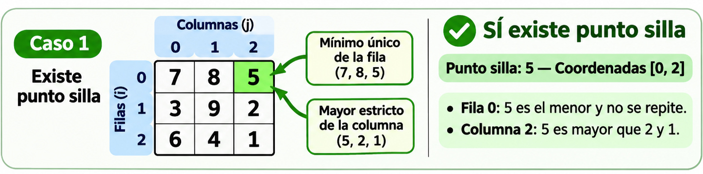
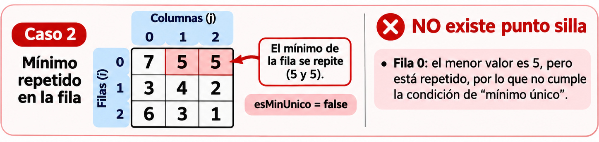
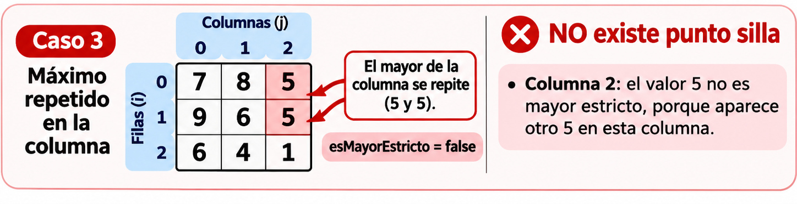

# Ejercicio 1 — Punto silla estricto

Un punto silla estricto es el mínimo único de su fila y el máximo estricto de su columna. Los índices comienzan en 0.

## Pruebas adicionales para IntelliJ

### Prueba 1 — Existe punto silla

```java
int[][] matriz = {
    {7, 8, 5},
    {3, 9, 2},
    {6, 4, 1}
};
```

- Fila 0: 7, 8, 5. El 5 es el mínimo único.
- Columna 2: 5, 2, 1. El 5 es el máximo estricto.
- `esMinUnico = true` y `esMayorEstricto = true`.
- Retorno: `{{0, 2}}`.

```text
Fila: 0
Columna: 2
Punto silla: 5
```



### Prueba 2 — El mínimo está repetido

```java
int[][] matriz = {
    {7, 5, 5},
    {3, 4, 2},
    {6, 3, 1}
};
```

- Fila 0: 7, 5, 5. El mínimo aparece dos veces.
- `esMinUnico = false`. Se descarta la fila aunque el primer 5 sea el máximo estricto de su columna.
- Los mínimos de las filas 1 y 2 tampoco son máximos de sus columnas.
- Retorno: `null`.

```text
No existe punto silla
```



### Prueba 3 — El máximo de la columna está repetido

```java
int[][] matriz = {
    {7, 8, 5},
    {9, 6, 5},
    {6, 4, 1}
};
```

- El 5 es el mínimo único de la fila 0 y de la fila 1.
- Columna 2: 5, 5, 1. Ninguno de los dos 5 es el máximo estricto.
- `esMinUnico = true` y `esMayorEstricto = false` para ambos candidatos.
- El mínimo de la fila 2 tampoco es máximo de su columna.
- Retorno: `null`.

```text
No existe punto silla
```



## Estructura mental para FEIP

| Paso | Instrucción | Objetivo |
|---:|---|---|
| 1 | `if` | Validar la matriz. |
| 2 | `for (i)` | Seleccionar la fila. |
| 3 | `for (j)` | Buscar el mínimo. |
| 4 | `boolean esMinUnico` | Controlar si se repite. |
| 5 | `for (k)` | Verificar verticalmente. |
| 6 | `boolean esMayorEstricto` | Controlar si es el mayor estricto. |
| 7 | `if` con `&&` | Comprobar ambas banderas. |
| 8 | `return` | Devolver las coordenadas. |

## Condición fundamental

```java
if (k != i && matriz[k][indiceMinimo] >= minimo) {
    esMayorEstricto = false;
    break;
}
```

`k != i` evita comparar el candidato consigo mismo. `>=` descarta valores iguales o superiores. `break` termina únicamente el ciclo de `k`.

## Complejidad del algoritmo

Para una matriz rectangular de n filas y m columnas:

- Temporal en el peor caso: O(n × m + n²).
- Espacial auxiliar: O(1).

**Recordatorio:** i selecciona, j busca y k verifica.

Guardá las tres imágenes JPG junto a este Markdown para verlas en Preview de IntelliJ.
